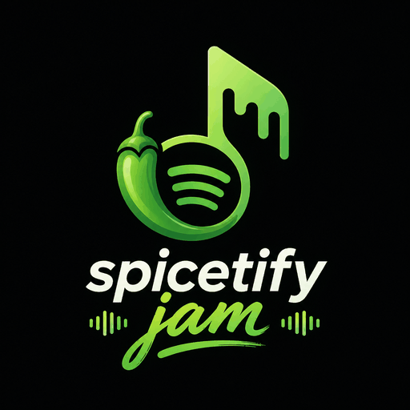

<div align="center">
  
  <br />
  

  <br /><br />

  

  <br /><br />

  <a href="https://github.com/Kyzenkms/spicetify-jam/releases">
    
  </a>
  <a href="https://spicetify.app">
    
  </a>
  <a href="https://github.com/Kyzenkms/spicetify-jam/stargazers">
    
  </a>
  <a href="LICENSE">
    
  </a>

  <br /><br />

  <a href="#features">Features</a> &nbsp;•&nbsp;
  <a href="#installation">Installation</a> &nbsp;•&nbsp;
  <a href="#how-to-use">How to use</a> &nbsp;•&nbsp;
  <a href="#updating">Updating</a> &nbsp;•&nbsp;
  <a href="#uninstalling">Uninstalling</a> &nbsp;•&nbsp;
  <a href="#troubleshooting">Troubleshooting</a>

  <br /><br />
</div>


## What's new in v1.4.2

- **Invite links now work.** Use **Copy Link** to share an invite that opens Spotify and joins your Jam.
- **QR codes open the invite page**, with a session code you can copy if needed.
- **Stay where you were.** Joining opens the Jam panel without leaving an invite in your search bar or taking you away from your music.
- **Clearer update alerts.** The Jam panel lets you know when a newer version is available and shows you how to update.

**Already installed?** You and your friends should rerun the [quick installer](#quick-install-recommended), then create a new Jam and share a fresh link.

## Features

<div align="center">

| | Feature | Description |
|:---:|---|---|
| 🎵 | **Perfect Playback Sync** | Listen together at the exact same second — when the host plays, pauses, or skips, everyone stays in tune |
| 🎶 | **Shared Party Queue** | Build the vibe together — anyone can add songs, remove tracks, or drag-and-drop to reorder live |
| 🎙️ | **Pass the Aux (Guest Controls)** | Host can grant control to friends so anyone can control the music |
| 👥 | **Live Friend Avatars** | See who's in the room with real Spotify profile pictures and live presence |
| 📌 | **Mini Player Widget** | A sleek floating widget keeping you connected to the Jam even when the sidebar is minimized |
| ⚡ | **Instant Room Invites** | Invite friends in seconds using a 6-character room code, QR code, or shareable link |
| 🔄 | **Seamless Auto-Sync** | Automatically keeps everyone in sync without pausing or interrupting the music |

</div>


## Installation

### Quick Install (Recommended)

Just run this. It downloads the latest build and sets everything up automatically.

**Windows (PowerShell):**
```powershell
irm https://raw.githubusercontent.com/Kyzenkms/spicetify-jam/main/install.ps1 | iex
```

**Linux / macOS:**
```bash
bash <(curl -fsSL https://raw.githubusercontent.com/Kyzenkms/spicetify-jam/main/install.sh)
```

That's it. Restart Spotify and look for the Jam icon `((•))` in the player bar.

---

### Manual Install (Developers)

**Requirements:** [Git](https://git-scm.com/downloads) · [Node.js v18+](https://nodejs.org/) · [Spicetify](https://spicetify.app/)

> **Windows:** Restart PowerShell after installing Git and Node.js.

**Windows**

```powershell
git clone https://github.com/Kyzenkms/spicetify-jam
cd spicetify-jam
npm install
npm run build
spicetify config extensions spicetify-jam.js
spicetify config custom_apps spicetify-jam
spicetify apply
```

**Linux / macOS**

```bash
git clone https://github.com/Kyzenkms/spicetify-jam
cd spicetify-jam
npm install
npm run build
spicetify config extensions spicetify-jam.js
spicetify config custom_apps spicetify-jam
spicetify apply
```


## Updating

Run the [quick installer](#quick-install-recommended) again, then restart Spotify. Both the host and guests should update before using the new invite links.

An **Update available** banner appears in the Jam panel when a newer version is detected. On an older installation, restart Spotify to check. Updates are installed by running the installer, not by clicking the banner alone.

<details>
<summary>Updating a manual installation</summary>

From inside your `spicetify-jam` folder:

```bash
git pull
npm install
npm run build
spicetify config custom_apps spicetify-jam
spicetify apply
```

</details>


## How to use

**As a host**

1. Click the **Jam icon** in the bottom-right of the Spotify player bar.
2. Click **Start a new Jam** in the sidebar.
3. Share your **Session ID**, **QR code**, or **join link** with friends.
4. Add songs via the sidebar or by right-clicking a track in Spotify and selecting **Add to Jam**.

**As a guest**

1. Click the **Jam icon** in the player bar.
2. Enter the host's **Session ID** or open their join link.
3. Playback syncs automatically. Resuming after a pause jumps you straight to the live position.

**Sharing an invite:** click **Copy Link** while hosting and send it to your friends. Links look like `https://kyzenkms.github.io/spicetify-jam/?jam=CODE`. Open the link and choose **Open Spotify** if your browser asks. The Jam panel opens and connects you to the host.

Both people need **Spotify desktop with Spicetify Jam installed and updated**. If you're on your phone, open the invite on your computer instead. You can also copy the 6-character session code and paste it into the Jam panel.

Spotify's built-in Jam links (`spotify.link/...`) do not work with Spicetify Jam. Ask the host to create a session from this extension's Jam panel.


## Uninstalling

### Quick Uninstall (Recommended)

**Windows (PowerShell):**
```powershell
irm https://raw.githubusercontent.com/Kyzenkms/spicetify-jam/main/uninstall.ps1 | iex
```

**Linux / macOS:**
```bash
bash <(curl -fsSL https://raw.githubusercontent.com/Kyzenkms/spicetify-jam/main/uninstall.sh)
```

---

### Manual Uninstall

```bash
spicetify config extensions spicetify-jam.js-
spicetify config custom_apps spicetify-jam-
spicetify apply
```

Then delete the extension file from your Extensions folder and `spicetify-jam` from your CustomApps folder.

---

## Troubleshooting

**"Connection timed out" when joining**

Spicetify Jam uses WebRTC (P2P) to connect directly between users. Strict NAT — common on university, corporate, or mobile carrier networks — can block this.

- Switch to a mobile hotspot
- Use a VPN
- Use a home network instead of public or institutional Wi-Fi
- Make sure both users are on the latest version

**The Jam icon doesn't appear after install**

Run `spicetify apply` again, or try:

```bash
spicetify restore apply
```

Then restart Spotify.

**`npm` or `git` is not recognized**

Install [Node.js](https://nodejs.org/) and [Git](https://git-scm.com/downloads), then restart your terminal.


## Contributing

Found a bug or have a suggestion? [Open an issue](https://github.com/Kyzenkms/spicetify-jam/issues) — contributions are welcome.

## License

MIT — see [`LICENSE`](LICENSE) for details.

<br />

<div align="center">
  
</div>
